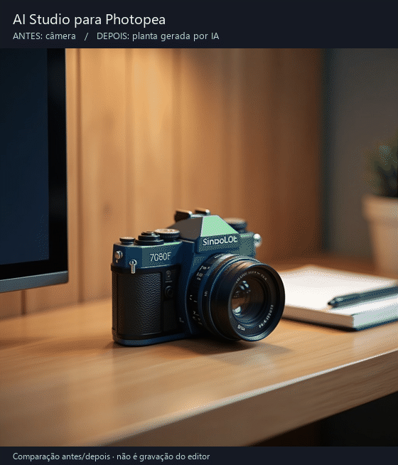

# AI Studio para Photopea

Plugin para editar áreas selecionadas de uma imagem usando IA. O resultado entra como uma nova camada no Photopea, preservando a original.



*Comparação antes/depois de um teste real, não uma gravação do editor.*

## Rodar

Node.js 22.18+ e npm.

```sh
npm ci
npm run dev
```

Abra a URL do Vite, clique em **Abrir no Photopea** e abra o painel **AI Studio** na lateral direita.

## Usar

1. Abra uma imagem e selecione a área que quer alterar. Inclua o objeto inteiro, as sombras e uma margem ao redor.
2. No painel, escolha **SDXL público** e clique em **Capturar Seleção do Canvas**.
3. Descreva a mudança, preferencialmente em inglês, e clique em **Aplicar Generative Fill**.
4. Confira a prévia, ajuste as bordas se necessário e insira como nova camada.

Os ajustes de borda são locais e não gastam outra chamada de IA. Capture novamente se mudar a seleção ou o tamanho do documento.

## Limitações

O projeto ainda é experimental. Substituições funcionaram nos testes, mas remoção de objetos e troca de cor nem sempre atenderam ao pedido. Confira o resultado antes de inserir.

O SDXL roda em um Space público do Hugging Face, sujeito a fila e cota de GPU. Um token próprio pode usar a cota da sua conta, sem garantir uso ilimitado. Configure em **Token Hugging Face → Usar nesta sessão**.

Imagens e prompts são enviados ao provedor escolhido. As chaves ficam na memória por padrão; a opção de guardar no navegador usa Base64, sem criptografia. Cancelar encerra a espera local, mas o servidor pode continuar processando.

Os outros provedores exigem chave própria, podem cobrar pelo uso e não foram todos validados. O proxy NVIDIA funciona apenas no servidor de desenvolvimento. O modo **Variação** está desativado.

## Testes

```sh
npm test
npm run lint
npm run build
```

Com o Vite ativo, há testes de canvas em `/tests/browser.html`, de integração em `/tests/photopea.html` e outros cenários em `/tests/readiness.html`. Esses testes usam fixtures do projeto. As chamadas reais de IA consomem cota; `npm test` não acessa os provedores.

## Publicar o plugin

```sh
npm run build
npm run manifest -- https://seu-dominio.example/ai-studio/
```

Hospede `dist/` em HTTPS. No Photopea, vá em **Window → Plugins → Add Plugin** e importe o `dist/manifest.json` gerado. O manifesto em `public/` aponta para localhost.

O GIF pode ser recriado com `python scripts/create-demo.py` (requer Pillow).
