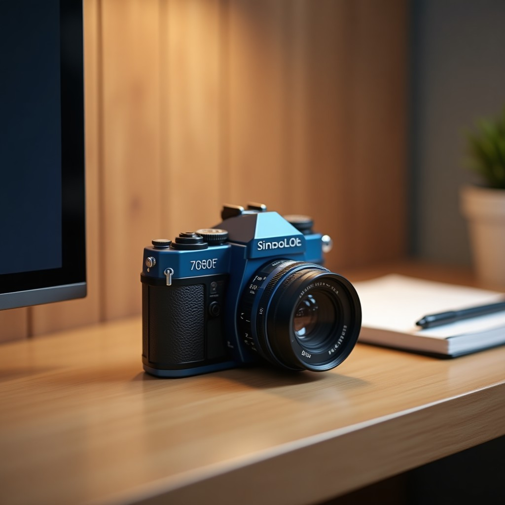
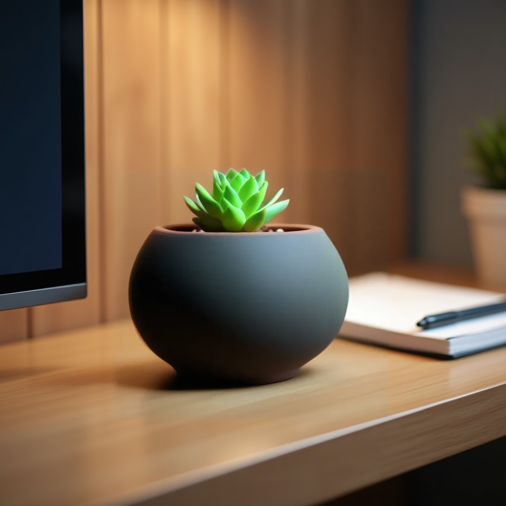
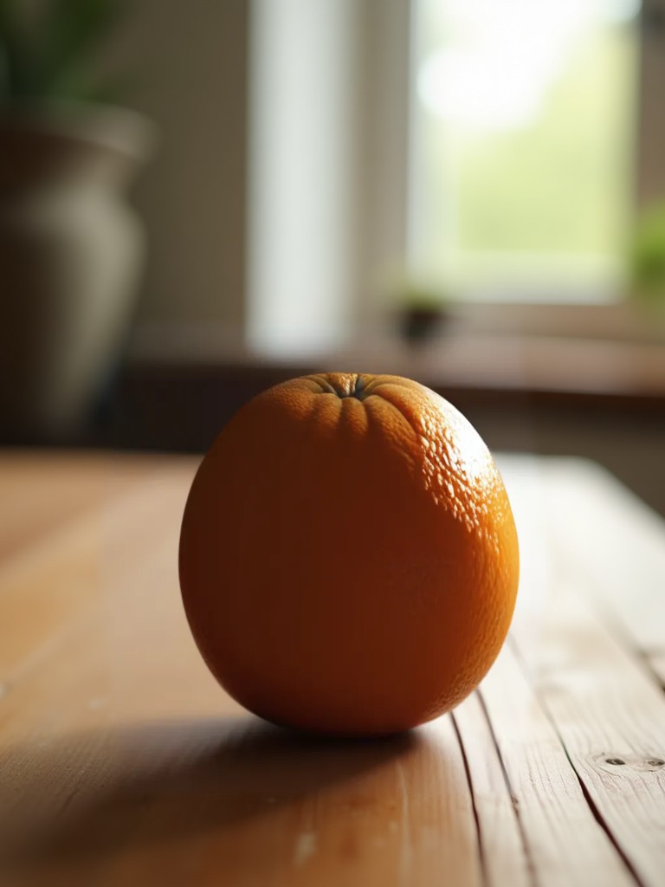
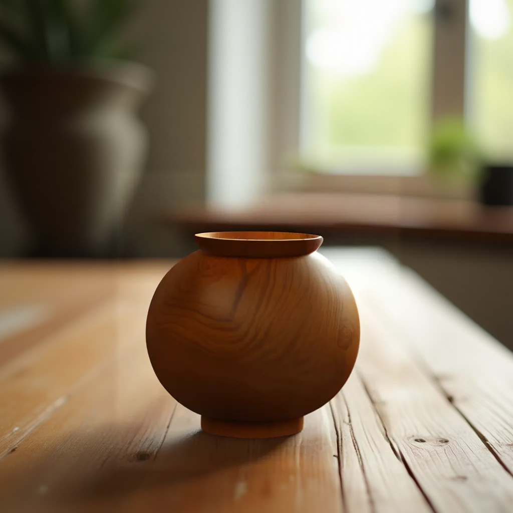
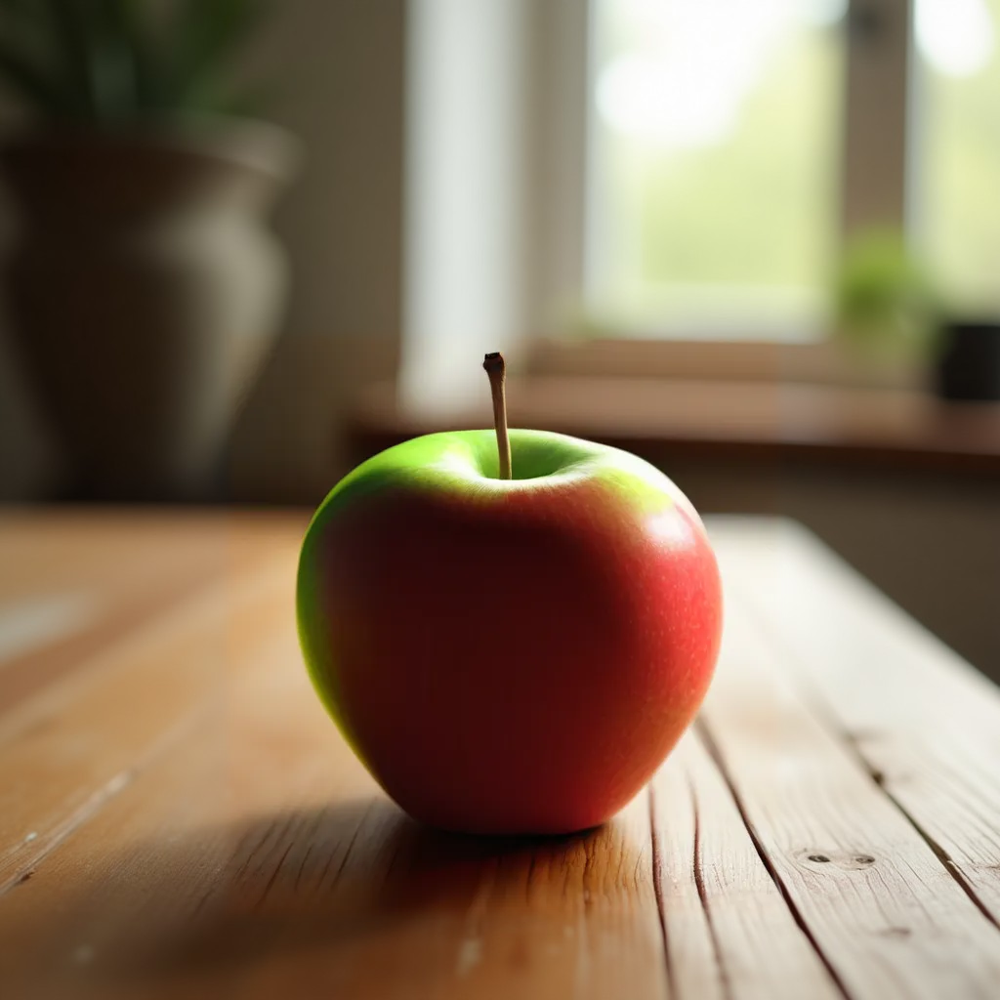

# Galeria de testes reais

As imagens são fixtures criadas com IA e resultados de chamadas reais ao serviço de inpainting. Não são fotografias pessoais. A comparação animada usa duas imagens estáticas; não mostra a interface nem o tempo de inferência.

## Substituição: câmera → planta

| Antes | Depois |
| --- | --- |
|  |  |

Esse exemplo melhorou após ampliar a seleção para incluir a lente e as sombras. O modelo não seguiu exatamente a cor de vaso pedida. Um resultado bem integrado não comprova acerto universal.

## Seleção irregular em documento vertical



Documento 768×1024. A troca de maçã por laranja passou na inspeção visual desse exemplo. O teste confirmou ausência de diferenças fora da seleção e diferença máxima de 1/255 entre prévia e Photopea.

## Falhas que fazem parte da avaliação

| Remover a maçã e deixar a mesa vazia | Fazer a maçã ficar verde |
| --- | --- |
|  |  |

A execução técnica passou nesses dois testes, mas o resultado solicitado não foi atendido. Por isso o projeto continua experimental.

Veja a [auditoria de prontidão](../AUDITORIA_PRONTIDAO.md). Logs e imagens intermediárias em `test-results/` são artefatos locais ignorados pelo Git; esta pasta contém a seleção pública de evidências.

## Recriar o GIF

Com Python e Pillow disponíveis:

```sh
python scripts/create-demo.py
```

Pillow é necessário apenas para recriar a animação, não para executar o aplicativo.
